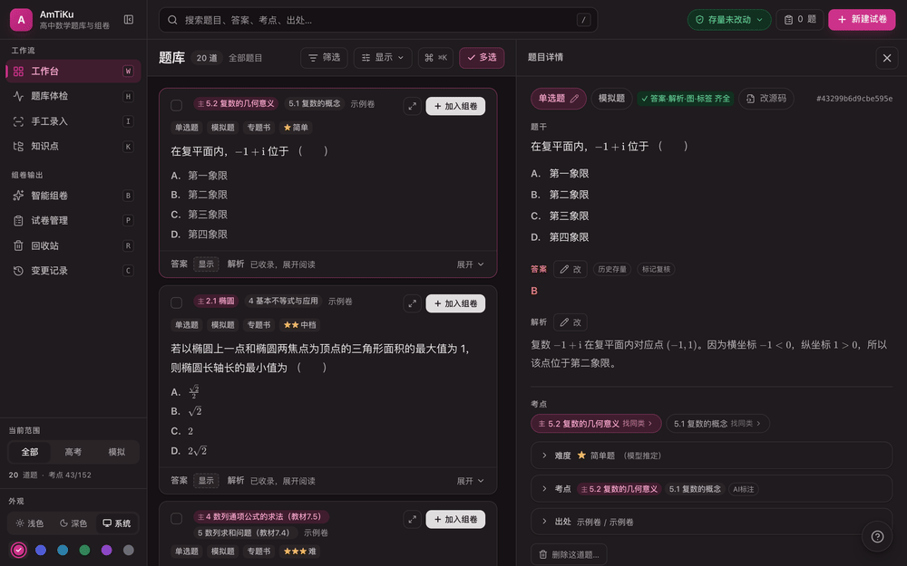

# AmTiKu · 高中数学题库与组卷系统



本地运行的题库与组卷工具：**检索 → 筛选 → 组卷 → 导出 PDF**。
离线可用，数据全在自己电脑里，不上传任何服务器。

## 下载

| 平台 | 文件 | 怎么装 |
|---|---|---|
| macOS（Apple 芯片） | [AmTiKu-2.0.0-macOS-arm64.dmg][mac] | 拖进「应用程序」；**首次在图标上右键 → 打开** |
| Windows（64 位） | [AmTiKu-2.0.0-Windows-x64.zip][win] | 解压到**纯英文路径**，双击 `AmTiKu.exe` |

[mac]: https://github.com/xiaoming-kun/AmTiKu/releases/download/v2.0.0/AmTiKu-2.0.0-macOS-arm64.dmg
[win]: https://github.com/xiaoming-kun/AmTiKu/releases/download/v2.0.0/AmTiKu-2.0.0-Windows-x64.zip

自带 Python、LaTeX、前端 —— **不需要再装任何东西**。校验和见 [Releases](https://github.com/xiaoming-kun/AmTiKu/releases/tag/v2.0.0)。

## 包里有什么

- **20 道示例题**：9 单选 / 3 多选 / 3 填空 / 5 解答，20 个互不相同的考点，5 张配图。
  出处信息已抹掉，题面、答案、解析与正式库一致。
- **152 个考点**大纲（课标体系）。
- 除示例题外**不含题库**。

接自己的题库：把 `题目/`、`图片/`、`知识点.json` 放进数据目录
（macOS `~/Library/Application Support/AmTiKu/`；Windows 放在 exe 旁边）。

## 从源码跑

```bash
python3 -m pip install -r requirements.txt
python3 amti.py 网页        # 起服务 + 打开浏览器
```

导出 PDF 需要 LaTeX 引擎；上面两个安装包已经内置。

## 题库数据

正式题库（全部真题与模拟题、答案与解析）**不公开、也不随代码授权**。
需要购买或授权使用，**加 QQ：3138046922**。

## 许可

- **代码**：MIT（见 `LICENSE`）
- **题库数据**：属于作者，保留所有权利，不在本仓库
- **考点大纲**（`demo数据/知识点.json`）：课标结构，随 MIT 一并提供
