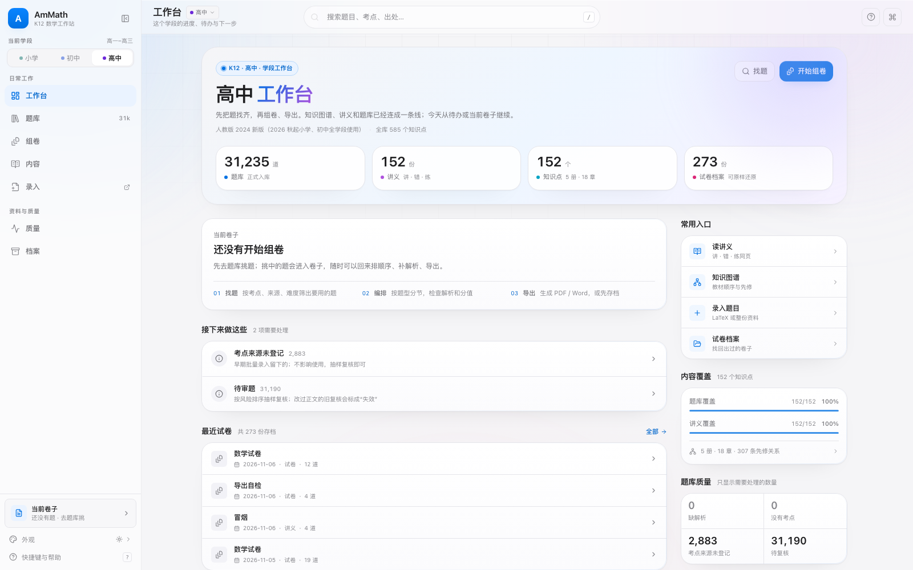
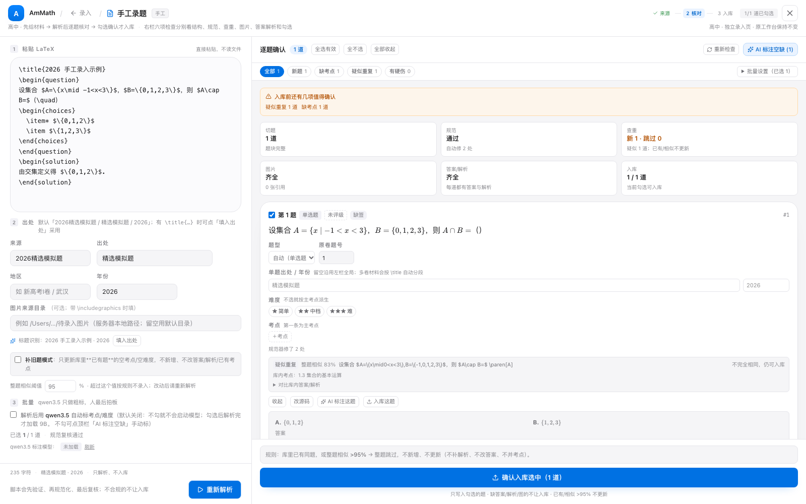
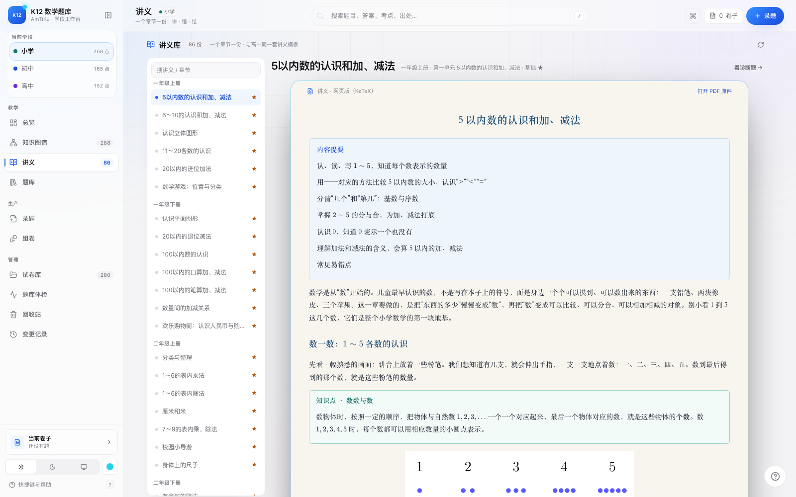

# AmMath · K12 数学工作站




本地运行的 K12 数学工作站：**小学 / 初中 / 高中**三学段各自一条内容生产线——
**知识图谱 → 讲义 → 题库 → 录入 → 组卷输出**。
离线可用，数据全在自己电脑里，不上传任何服务器。

> 产品名是 **AmMath**。历史安装包、数据目录和仓库名仍沿用 `AmTiKu`，升级时不需要改名或搬数据。

## 下载

| 平台 | 文件 | 怎么装 |
|---|---|---|
| macOS（Apple 芯片） | [AmTiKu-2.0.0-macOS-arm64.dmg][mac] | 拖进「应用程序」；**首次在图标上右键 → 打开** |
| Windows（64 位） | [AmTiKu-2.0.0-Windows-x64.zip][win] | 解压到**纯英文路径**，双击 `AmTiKu.exe` |

[mac]: https://github.com/xiaoming-kun/AmTiKu/releases/download/v2.0.0/AmTiKu-2.0.0-macOS-arm64.dmg
[win]: https://github.com/xiaoming-kun/AmTiKu/releases/download/v2.0.0/AmTiKu-2.0.0-Windows-x64.zip

> 源码版本：3.0.0（`VERSION`）。上表安装包仍是已发布的 v2.0.0，V3 构建后替换。

自带 Python、LaTeX、前端 —— **不需要再装任何东西**。校验和见 [Releases](https://github.com/xiaoming-kun/AmTiKu/releases/tag/v2.0.0)。

## 界面怎么走

AmMath 把原来平铺的 11 个入口收成 **7 个工作区**，同类页面用二级标签切换：

| 工作区 | 里面有什么 | 什么时候用 |
|---|---|---|
| **工作台** | 当前卷子、接下来、最近试卷、覆盖与质量 | 每天打开先看「下一步做什么」 |
| **题库** | 筛选（考点可切**并集/交集**）、题目列表、详情、加入卷子；**套卷**标签按原题号还原整份外来卷 | 找题、挑题、补答案与解析；整卷进卷子 |
| **组卷** | 当前卷子、卷面结构、智能组卷、导出 | 把题排成一份能印的卷子 |
| **内容** | 知识图谱 / 讲义 | 按教材顺序备课、看先修、读讲义 |
| **录入** | 手工录题 / DeepSeek 录题 / 整理题库 / 题目校对；独立标签页 | 录入新题、整理已有题或校对单题 |
| **质量** | 题库体检 / 审阅 | 查覆盖缺口、复核风险题 |
| **档案** | 试卷库 / 回收站 / 变更记录 | 找回旧卷、恢复误删、查批量改动 |

- **学段是全局视角**：顶栏或侧栏切小学 / 初中 / 高中，当前工作区不丢。
- **顶栏搜索是全局入口**：任何页面输入就进入题库结果；公式、字段语法都支持。
- **录入是独立页**：从任意页面点「录入」都在新标签页打开；原页面不被替换，录完回来刷新即可。
  这个页面没有工作台侧栏/搜索栏，只保留 AmMath 录入页头，关闭标签页就回到原工作台。
  选择页顶部会显示 **今日 / 累计 DeepSeek 花费与 token**，按本地调用流水估算；以控制台账单为准。
- **DeepSeek 整理题库**：扫描已有题中「缺考点 / 缺解析 / 缺答案」的题，DeepSeek 只返回建议；
  逐条勾选后才通过现有单题接口写回，不新增题目、不改题干。扫描只查本地缺口索引、一次最多 10 道，不会把整个题库发给 DeepSeek。
- **题目校对**：从题库选一道已有题，DeepSeek 独立做一遍，检查答案、解法步骤和配图；
  答案/解析建议逐项勾选后才写回，TikZ 建议在源码校对里确认。AI 花费在读取报告里用红色大字显示。
  每题卡还有「DeepSeek 修复」：把这道题的校验报错和源码发回去只修 LaTeX，修完重新预览，不直接写库。
- **DeepSeek 录题顺序**：先连接 → 再配对试题/答案 → 明确点「确认开始读取」才计费；
  读取中显示当前阶段、页数和取消；规范驱动输出后给出页数/题数/待补/费用报告，原文页固定在另一列与题卡对照。
  勾选「缺解析的题让 DeepSeek 补写解析」时，补写内容会标为模型解析，入库前必须逐题核对。
- **组卷是出口**：题目卡片上的「加入卷子」只把题放进当前卷子，不打断找题；
  顶栏出现「继续组卷」后，随时可以回到卷子编排。
- **题库**：高中是完整工作台（筛选 / 卡片 / 详情 / 加入卷子）；小学、初中走**诊断题库**，按册章筛、点开看答案。
- **讲义**：三个学段同一套 elegantbook 模板。高中一个考点一份（152 份，讲 · 错 · 练同页，
  可导出教师版 / 学生版）；小学 / 初中一个章节一份（小学 86 章 + 初中 34 章，共 120 份，
  每章 3–5 页为主，讲 · 错 · 结，不排练习，点「看诊断题」进诊断题库）。
- **录入**在**新标签页**打开，分四种模式：**手工录题**只接受粘贴 LaTeX（不再选文件/读图）；**DeepSeek 录题**只接受 PDF / 图片；试题和答案都可以多选，选文件只是暂存，点「确认开始读取」才上传计费；**整理题库**和**题目校对**只给建议，确认后才写回。核对后入库；没有答案或解析的题默认不收，可显式勾选让 DeepSeek 补写解析。原工作台的筛选、卷子和详情都保留。
- **组卷**：当前卷子 + 智能组卷 + 导出 PDF / Word / 分享包；出过的卷子自动存进**试卷库**，只记题号，随时原样还原。
- **审阅**：风险队列 + 分层抽样；通过/需修改/存疑会记复核人和正文指纹，正文一改原复核自动失效。



这次信息架构与视觉重构的依据、GitHub 同类项目调研和改动清单，见
[`docs/界面重构-AmMath.md`](docs/界面重构-AmMath.md)。



## 包里有什么

- **20 道示例题**：9 单选 / 3 多选 / 3 填空 / 5 解答，20 个互不相同的考点，5 张配图。
  出处信息已抹掉，题面、答案、解析与正式库一致。
- **152 个高中考点**大纲（课标体系），以及 **585 个知识点 / 940 条先修关系**的教材知识地图（小学—高中，人教版册/章顺序）。
- **120 章小初章节讲义**：小学 86 章、初中 34 章，按人教版册 / 章归位；
  与高中同一套 elegantbook 模板，每章 3–5 页为主，含知识点、方法、例题、TikZ 图、
  三线表、小结和教材溯源。
- 除示例题外**不含题库**。

接自己的题库：把 `题目/`、`图片/`、`知识点.json`、`知识地图.json`、`小初诊断题.json` 放进数据目录；
小初讲义源在 `数据/专题/小初/content/`（清单见 `数据/专题/小初/manifest.json`），
开源素材与许可见 `数据/开源讲义/`
（macOS `~/Library/Application Support/AmTiKu/`；Windows 放在 exe 旁边）。

## 从源码跑

```bash
python3 -m pip install -r requirements.txt
python3 amti.py 网页        # 起服务 + 打开浏览器
```

导出 PDF 需要 LaTeX 引擎；上面两个安装包已经内置。

导出 Word 需要本机 **Pandoc**（`brew install pandoc` / `choco install pandoc`），
安装包暂未内置；TikZ 几何图在 Word 里不渲染，复杂版式以 PDF 为准。
前端改动后要重新构建：`cd web && npm run build`（后端直接发 `web/dist/`）。

## 题库数据

正式题库（全部真题与模拟题、答案与解析）**不公开、也不随代码授权**。
需要购买或授权使用，**加 QQ：3138046922**。

## 许可

- **代码**：MIT（见 `LICENSE`）
- **题库数据**：属于作者，保留所有权利，不在本仓库
- **考点大纲**（`demo数据/知识点.json`）：课标结构，随 MIT 一并提供
- **小初章节讲义**：AmMath 自编；其中参考开源内容的章节保留原作者与许可
  （MIT / LPPL-1.3c），来源与许可见 `数据/开源讲义/README.md`，应用内每章也标了作者与链接
- **界面动效组件**：`web/src/app/reactbits/` 下的 SpotlightCard 来自 React Bits，
  按 MIT + Commons Clause 使用（见该目录 `LICENSE.md`），不适用本仓库的 MIT 许可
