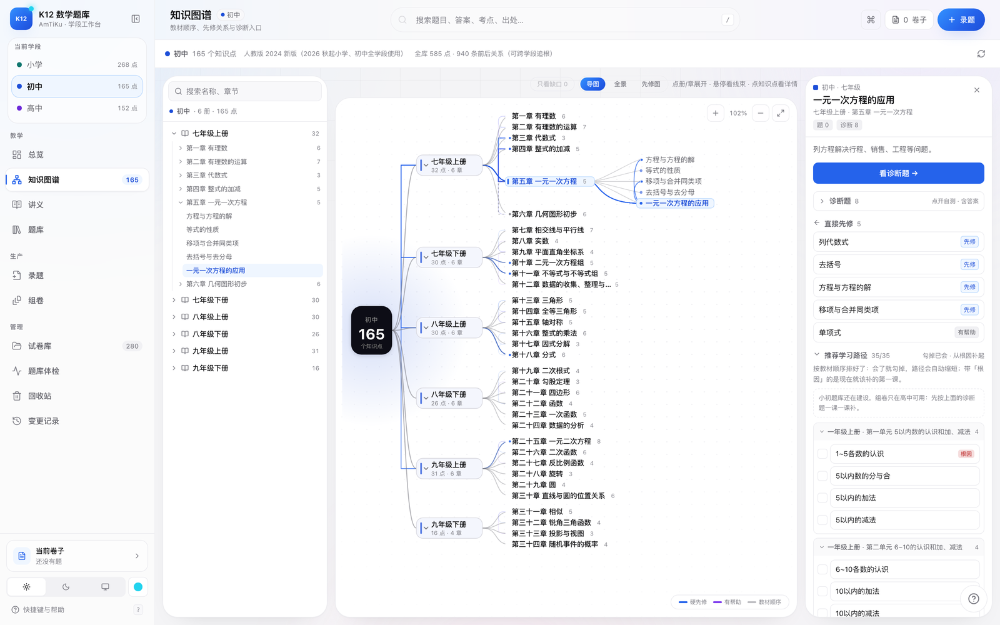
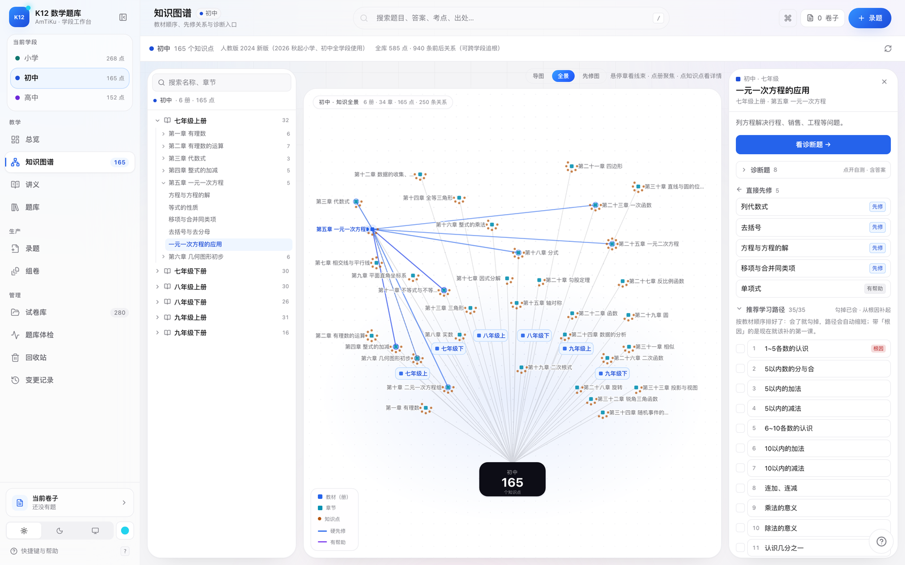
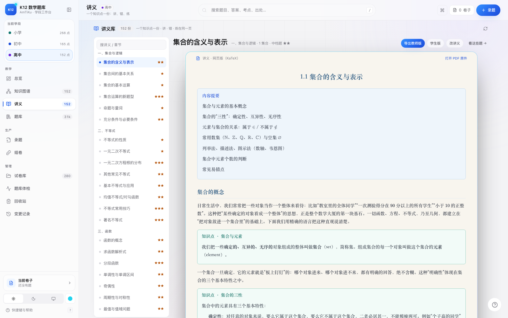
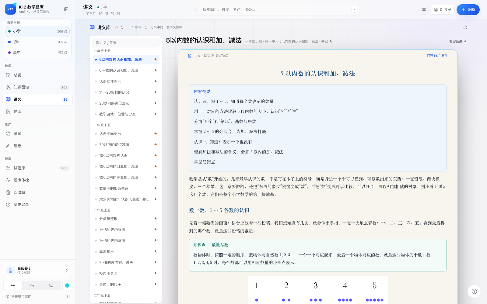
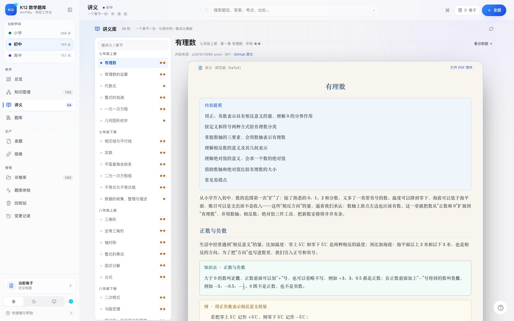
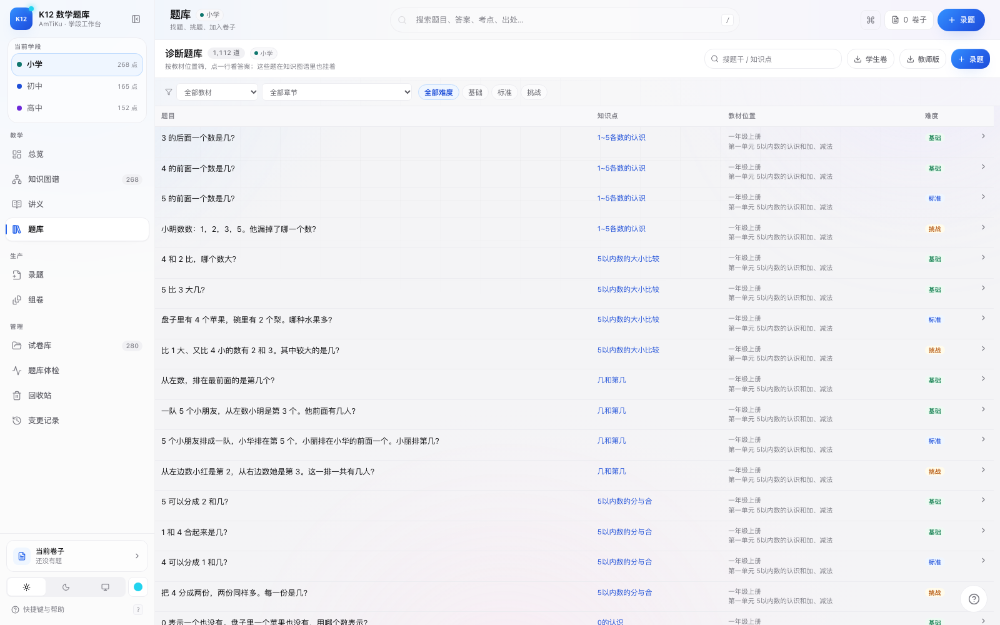
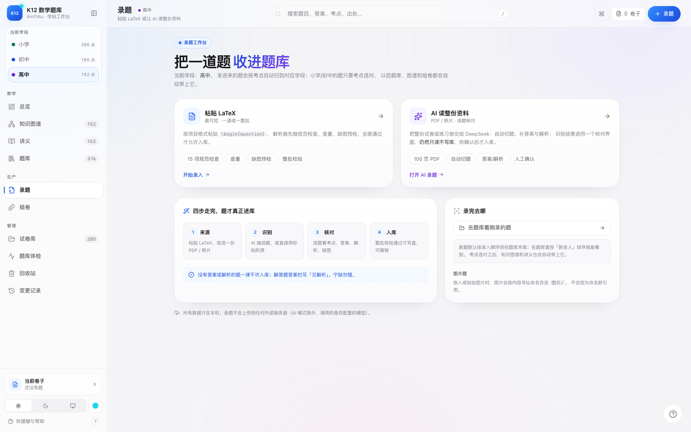
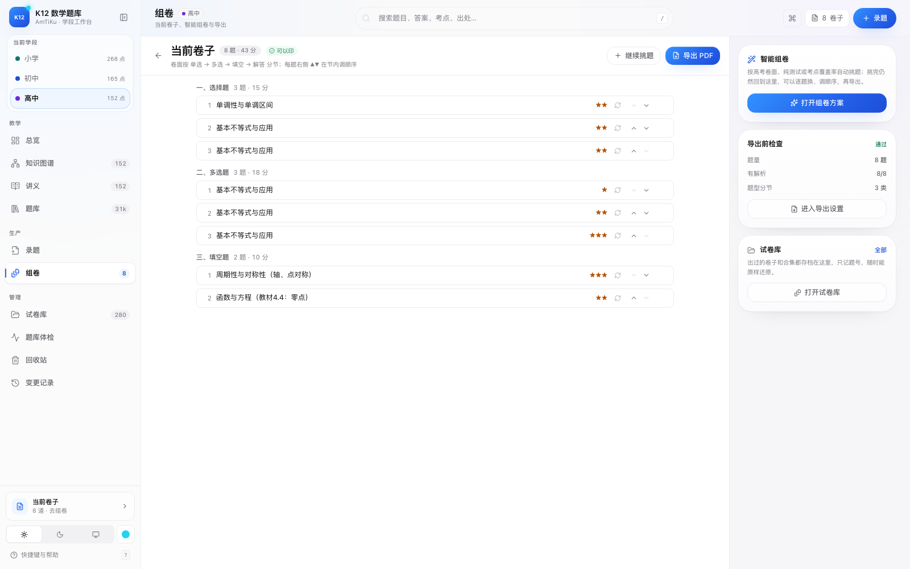
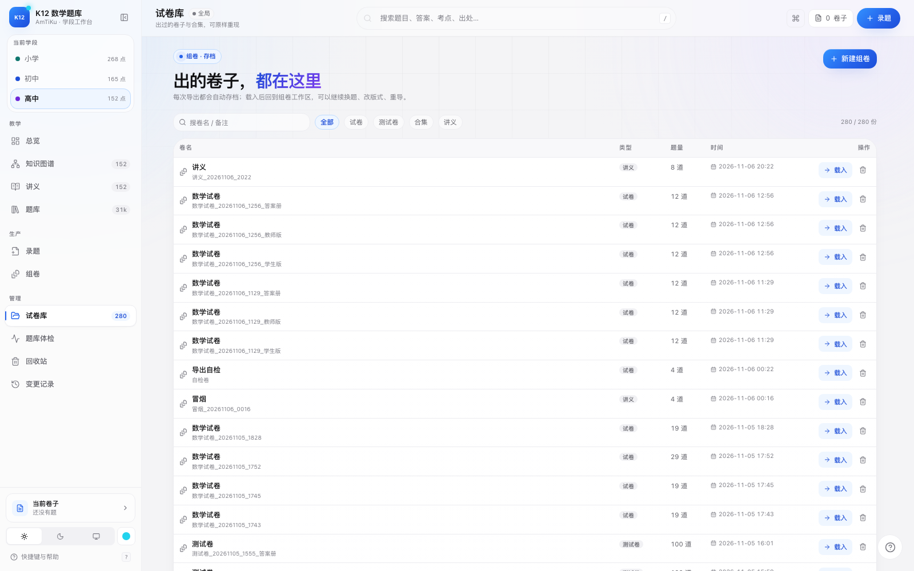
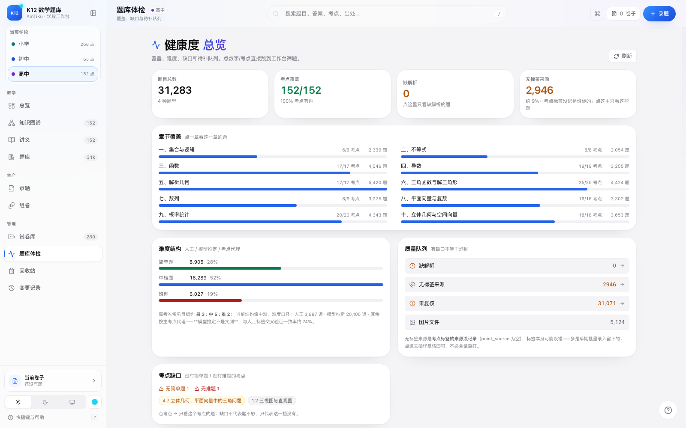

# 功能一览

> 截图全部来自本机真实运行（题库为作者私有数据，**不在本仓库中**；把题库放到
> `题目/`、`图片/`、`知识点.json`、`知识地图.json`、`小初诊断题.json` 即可复现同样的界面）。

## 0. 一句话

**学段优先**：左上角常驻小学 / 初中 / 高中，切学段之后，知识图谱、讲义、
题库、组卷都换口径。左侧只放工作区：

> 总览 · 知识图谱 · 讲义 · 题库 · 录题 · 组卷
> 管理面：试卷库 · 题库体检 · 审阅 · 回收站 · 变更记录

## 1. 总览：今天该做什么

一屏看这个学段的四段流水线：

* **知识图谱**：多少知识点、多少册章、多少条先修关系；
* **讲义**：多少份、覆盖了多少知识点；
* **题库**：多少道题、覆盖多少个知识点、题型分布；
* **组卷**：出过多少份卷子、最近一份是什么。

下面是**待办**：缺解析、没考点、考点来源未登记、待审题、小初题库建设中……
点一条直接跳到对应的筛选。三个学段的进度卡也在这一页，点一下切过去。

小学/初中题库还在建设时，总览会如实写「0 题 + 诊断题 N 道」，
不会给一块空白让人以为坏了。

## 2. 知识图谱

三栏：**左目录、中知识图谱（导图 / 全景 / 先修图）、右详情**。

* 左栏按人教版教材顺序：册 → 章 → 知识点，搜索名称/章节；
* 中间默认是**教材导图**：学段在左，按册分枝，点册展开章、点章展开知识点；
  章名后面是知识点数量，点任意知识点右侧就换成它的详情；
* **先修关系是线束，不是乱线**：同册的关系并到册脊上，跨册的沿枝条退到册签、
  走学段主干，再进目标册；悬停一章或选中一个知识点时，它进出的那条链会亮起来，
  端点用小圆点标出（硬先修蓝、有帮助紫、教材顺序灰虚线）；
* `+ / − / 适配` 缩放；只有交互时重绘，没有常驻动画；
* 可切「全景」：学段在**底部中心**，册/章/知识点按类型散在上方扇形里
  （蓝方块=册、青方块=章、琥珀点=知识点），从中心拉出的细线就是这把扇子的骨架；
  章名横向写、贴着节点，悬停或点章把那一章的**先修线束**拉出来
  （硬先修蓝、有帮助紫、教材顺序灰点线）；小学 86 章太密时不挂全部章名，
  点册签可聚焦那一册；
* 全景里类型分色 + 左下角图例 + 顶部「N 册 · M 章 · K 点 · R 条关系」，和教材层级对得上；
* 右栏每个知识点标「题 / 诊断」数量；**推荐学习路径按「册 · 章」分组**，勾掉已会会记在本机
  （localStorage，刷新不丢），导图上对应的点打勾；高中还能**按这条路径一键组卷**
  （每个未掌握点挑 1–2 道带解析的题，直接并进当前卷子）；
* 顶部**只看缺口**：列出既没有题、也没有诊断题的待建点（小学 2 个；初高中为 0 时按钮置灰）；
* 顶栏可切「先修图」：以上下分层看直接先修/后续；向上 1/2/3/全部 层，向下 1/2 层；
* 右栏：直接先修/后续、**推荐学习路径**（按教材顺序，勾掉已会就自动缩短，
  带「根因」的是现在该补的第一课）、诊断题；
* 高中点「看这些题」回题库；小初点「看诊断题」进诊断题库；
* 可跨学段追根：小学的知识点会出现在初中的先修链里。

## 3. 讲义

三个学段**同一套讲义模板**：elegantbook 讲义源 → PDF 原件 → 网页版（HTML + KaTeX）。
小学/初中按**章**一份（小学 86 章、初中 34 章，共 120 份），
高中按**考点**一份（152 份）。

* **正文**：内容提要、叙述性引入、知识点/方法/核心思路、例题、TikZ 图、三线表、
  本节小结和「教材溯源」框；小学/初中每章 3–5 页为主，和高中同一套版式；
* **网页版**：正文可选中、可搜索，公式走 KaTeX；TikZ 图在服务端单独编译成 PNG；
* **易错点与总结**：随讲义末尾一起排，不另挂卡片；
* **练习**：高中在讲义后接 3+3+2 道精选题，可增删、双击讲义插题、
  导出教师版 / 学生版；小学/初中**只做讲义、不排练习**，点「看诊断题」进诊断题库；
* 左栏按册 / 章（小初）或专题（高中）选，右侧同一张纸阅读；
* 右上角「打开 PDF 原件」看 LaTeX 原版；高中还有「改讲义」，
  小初的源在 `数据/专题/小初/content/*.json`，改完重渲染即可。

### 小学 / 初中：120 章章节讲义

* **小学 86 章**：人教版一至六年级全目录，按册 / 章归位；
* **初中 34 章**：七至九年级全目录；
* 每章覆盖本章全部知识点，含至少一幅 TikZ 图或一张表；
* 练习不在讲义页，点右上角「看诊断题」按本章知识点进诊断题库；
* 有开源来源的章节在标题下保留作者、许可和原文链接（MIT / LPPL），
  其余为 AmTiKu 自编；来源与许可说明见 `数据/开源讲义/README.md`。

## 4. 题库

### 高中：完整工作台

* 左侧筛选面板：章 → 节 → 考点的课标树，题型、难度、年份、完整度、地区、来源；
* 中间题目卡片：来源 / 考点 / 难度 / 完整度、题干 + 选项预览、答案遮罩；
* 右侧题目详情：题干、选项、答案、解析、考点、出处；可改答案/解析/考点/源码；
* 勾选后可批量加卷子、改标签、删除；跨页勾选不会丢；
* 表头「筛选胶囊」：一条一个 ×，点掉哪条撤哪条；
* 列表密度、密排、答案遮罩、每页条数都可调。

### 小学/初中：诊断题库

按册 / 章 / 难度 / 关键词筛，点一行看答案与解析（答案默认遮住）。
右侧可「在知识图谱中查看」；工具栏可把当前筛选的前 20 道导出成
**学生卷 / 教师版**诊断卷 PDF。

## 5. 录题

两个入口，最终都走同一套「逐题核对 → 勾选入库」：

* **粘贴 LaTeX**：一道或一整批；15 项规范检查、查重、缺图预检，全部通过才入库；
* **AI 读整份资料**：整份 PDF / 照片 + 标准规范交给 DeepSeek，模型直接输出规范 `.tex`、参数、考点和图清单；本地 preview 通过后才进核对界面（不依赖本地模型）；
  仍然**只读不写库**，你确认后才入库。

没有答案或解析的题一律不许入库；解答题答案栏写「见解析」。宁缺勿错。
AI 模式会把资料发到 DeepSeek 服务器，涉密资料请用本地那条路。

## 6. 组卷与试卷库

* **当前卷子**：按 单选 → 多选 → 填空 → 解答 分节；每题可换题、
  在节内上移/下移、移出；右侧是导出前检查（题量/有解析/题型分节）；
* **组卷方案**：高考卷 / 纯测试题 / 讲义；
  支持随机组卷、加本页、单题换题；
* **导出**：学生版 / 教师版 / 答案册；紧凑版 / 留空版；印不印出处、答案放卷末等；
* 小初学段的组卷页直接走**诊断卷**：在诊断题库筛好范围，一键出学生卷/教师版。

每次导出自动存进**试卷库**（只记题号，随时原样还原、继续改）。
可按类型筛、搜卷名、载入回组卷工作区、删除存档（不删题）。

## 7. 审阅工作台

* **风险队列**：按“来源不可追溯 / 解析悬空图 / 模型标注 / 内容改过”排序；
  每条风险都带原因，不做黑箱评分。
* **分层抽样**：按 `book × 题型` 抽 50/100/200 道，固定 seed 可复现；
  复核完按批次算错误率与 Wilson 95% 置信区间。
* **一次决定**：通过 / 需修改 / 存疑，写复核人、备注和正文指纹；
  正文一改，原复核自动失效（stale），不会再冒充“已复核”。
* 默认**遮住答案**，先自己判再按 `V` 显示；`J/K` 上下、`A/F/G` 做决定。
* 「CSV」导出当前队列/样本，含风险原因、来源、复核人、备注和批次。
* 题目右上角「去题库改源码」：跳到题库详情并自动打开源码编辑器。

> 旧版“改答案时顺手写 reviewed_at”会把 210 道只是改过错字的题算成已复核；
> 现在统计口径拆成 `review_status` 与 `edited_at`，体检页的“待审题”才是真的待审。

## 8. 题库体检 / 回收站 / 变更记录

* **题库体检**：题目总数、考点覆盖、缺解析、无标签来源、章节覆盖、难度结构、
  质量队列、考点缺口；点数字/考点直接跳到工作台筛题；
* **回收站**：删除的题都在这儿，可恢复；清空需要口令；
* **变更记录**：每次批量改动的账本。

## 9. 快捷键

| 键 | 去哪 |
|---|---|
| `O` / `M` / `T` | 总览 / 知识图谱 / 讲义 |
| `B` / `I` / `P` | 题库 / 录题 / 组卷 |
| `S` / `H` / `R` / `C` | 试卷库 / 题库体检 / 回收站 / 变更记录 |
| `⌘K` | 命令面板 |
| `/` | 聚焦顶栏搜索 |
| `↑` `↓` | 题库列表里移动 |
| `Enter` | 打开当前题详情 |
| `空格` | 勾选当前题（Shift 连选） |
| `⌘↵` | 当前题加入卷子 |
| `?` | 快捷键表 |
| `Esc` | 关闭弹层/详情/多选 |

单键只在**没有停在输入框里**时生效（打中文不会误触）。

---

* 想自己试：见 README 的「从源码跑」。
* 遇到问题：见 [常见问题](常见问题.md)。
